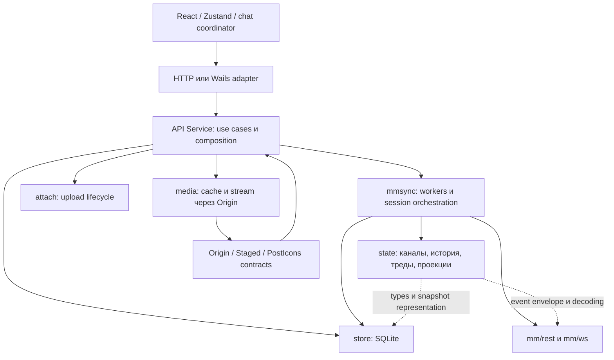

# Аудит spk-mm-client: корректность, производительность и границы

Дата: 2026-10-12. Базовый commit:
`77b77102b027de1346ff32597ebdf44dbfec802c`.
Проверялось рабочее дерево с уже внесённым исправлением восстановления сети
из предыдущей задачи. Установленный клиент сообщает `1.0.0`; аудит не
проверяет отсутствие этих дефектов в какой-либо опубликованной версии.

**Результат: 5 воспроизведённых дефектов и 1 измеренная проблема масштабирования.**
Основное разделение компонентов пригодно для этого приложения. Самые важные
пробелы — согласованное завершение сессии, изоляция положительного медиа-кэша
по аккаунтам и стоимость полного снимка длинной истории.

P1 — исправить перед следующим выпуском; P2 — следующий набор исправлений.
Приоритет отражает последствия, а не частоту, которую этот аудит не измерял.
В ходе самого аудита исходная логика не менялась. Ниже сохранены наблюдения
и их исходные воспроизведения. **2026-10-13: A1–A6 исправлены и проверены локально в рабочем дереве.** Текущее состояние: [исправления](fixes.md).

## Подтверждённые находки

| ID | Приоритет | Наблюдение | Проверка |
| --- | --- | --- | --- |
| A1 | P1, исправлен локально | Старое завершение GitLab SSO снова включает сессию после Logout | После исправления — 20 regression-сценариев с `-race` |
| A2 | P1 | Положительный медиа-кэш выдаёт байты прошлого аккаунта после выхода/смены аккаунта | Go probe, 200 из кэша при 403 upstream |
| A3 | P2 | Скачивание сохраняет файл после возвращения `Service.Close` | Go probe с удержанным HTTP body |
| A4 | P2 | Старый ответ ListServers откатывает новое состояние UI | Vitest probe с переставленными ответами |
| A5 | P2 | Позднее уведомление открывает тред покинутого канала | Vitest probe: канал B, тред канала A |
| A6 | P2 | Полный ChannelView и JSON растут вместе со всей загруженной историей | Go benchmarks, размер реального JSON |

### A1. Logout не инвалидирует уже начавшееся завершение SSO

Места: [Logout](../../../internal/api/service.go), строки 265–280;
`HandleDeepLink`, строки 286–318; [auth.SSO.Complete](../../../internal/auth/sso.go).

Порядок: пользователь уже вошёл → начинается GitLab SSO → его `Me` удержан
в сети → `Logout` успешно заканчивается и `SignedIn=false` → старый `Me`
отпускается → `HandleDeepLink` записывает токен и запускает воркер,
`SignedIn=true`. Тест `TestLogoutCancelsPendingGitLabLogin` проверяет отмену
**до** callback, а не этот порядок.

`Complete` удаляет pending-запись перед REST-проверкой. Последующий `Cancel`
при Logout уже не имеет объекта, который мог бы отменить. Менеджер сериализует
Start/Stop, но не всю операцию установки сессии вместе с БД и SSO.
Это логическая гонка, поэтому зелёный детектор гонок памяти её не исключает.

Исправление: поколение сессии на сервер; Logout/Remove/новый вход меняют
поколение и отменяют старый login context. Установка токена и запуск воркера
допускаются лишь для актуального поколения. Сеть не следует выполнять под
глобальным локом; проверка поколения и локальная фиксация должны составлять
одну короткую операцию. Password-вход также нужно включить в этот контракт:
его похожий путь просмотрен, но отдельное воспроизведение в этом аудите
выполнено именно для SSO.

### A2. Кэш медиа не принадлежит аккаунту

Места: [Cache.get](../../../internal/media/media.go), строки 460–481;
`Logout` очищает `store.ClearCache` в SQLite, а
[activate](../../../internal/api/sync.go) также очищает только SQLite при смене пользователя.

Ключ положительного кэша — `server/kind/object/variant`, без пользователя.
При попадании `Cache.get` возвращает имя файла до обращения к `Origin`.
Воспроизведение: alice кэширует thumbnail, выходит; тот же URL возвращает
200. Затем входит bob; прямой upstream-запрос получает 403, но тот же URL
по-прежнему получает 200 из кэша, без нового запроса к серверу.

403 в тесте задан контролируемо: это проверка обхода проверки доступа,
а не утверждение, что реальный bob не имеет доступа к публичному seed-файлу.
Наблюдение относится к изоляции аккаунтов **в одном локальном профиле**;
удалённый способ эксплуатации не устанавливался.

Исправление: медиа-scope `server + user`, проверка текущего signed-in scope
до положительного попадания, отмена/инвалидация старых inflight/negative
записей при смене аккаунта. Офлайн-чтение остаётся разрешённым для того же
вошедшего аккаунта. Кэш WebView с `immutable` также требует URL с аккаунтным
scope; одной очистки Go-кэша недостаточно. Загрузки, явно сохранённые
пользователем на диск, — отдельный контракт, их не нужно удалять автоматически.

### A3. У скачиваний нет владельца, завершающего их вместе с сервисом

Места: [saveFile/shared](../../../internal/api/files.go), строки 98–159;
[Service.Close](../../../internal/api/sync.go), строки 48–56;
[Wails DownloadFile/OpenFile](../../../internal/api/transport/wails.go), строки 130–135.

`saveFile` получает воркер, но дальнейший transfer связан лишь с контекстом
вызывающего. Desktop-адаптер даёт `context.Background`; загрузка имеет
общий предел 30 минут. `Close` ждёт uploads и sync workers, но не downloads.

Тест удержал уже начатое HTTP body, вызвал `Close`, убедился, что запрос
остался жив, и отпустил байты. Файл успешно сохранился **после** Close.
Это доказательство нарушения in-process lifecycle, а не утверждение, что
горутина продолжает жить после завершения OS-процесса. Поздние записи
результата могут пересечь закрытие store; потенциальные последствия —
неполная запись результата и оставшиеся `.part` при завершении процесса.

Исправление: владелец downloads с контекстом сервиса, отменой и WaitGroup,
запретом запуска после закрытия. Привязать transfer к поколению сессии либо
явно определить разрешённое поведение при Logout. У shared-download
контекст владельца должен быть независим от первого UI-waiter: отмена
одного ожидающего не должна ломать скачивание для остальных.

### A4. Список серверов не защищён от позднего ответа

Место: [refreshServers](../../../frontend/src/chat.ts), строки 105–122.

Для sidebar/channel/thread есть поколения, для ListServers — нет.
Старое чтение со `signed_in=true` удержано; новое со `false` применено;
старый ответ отпущен и перезаписал UI на `true`.

Backend-сессию эта находка сама по себе не восстанавливает: речь о неверном
UI, состояниях подключения, бейджах и лишних запросах до следующего события.
Исправление: монотонное поколение/сериализация refreshServers, с проверкой
перед применением; не сбрасывать выбор и ошибку при обычных обновлениях бейджей.

### A5. Навигация из уведомления защищена только наполовину

Место: [openFromNotification](../../../frontend/src/chat.ts), строки 212–215.

Уведомление начинает открывать A/ra. Пока ответ открытия A задержан,
пользователь открывает B. Поздний ответ A корректно отбрасывается через
`channelSeq`, однако `openFromNotification` после await безусловно запускает
`openThread(A, ra)`. Probe подтверждает одновременно `channel.id=B` и
`thread.channel_id=A`.

Исправление: поколение **всей** навигации канал→тред с проверкой после await,
как у `jumpToPost`. Открытие должно сообщать, применилось ли оно, а не
завершаться одинаковым `void` при применении и вытеснении. Проверить также
смену сервера и закрытие панели во время этой операции.

## A6. Производительность длинной истории

Места: [ChannelView](../../../internal/state/view.go), строки 139–205;
[api.OpenChannel](../../../internal/api/chat.go), строки 74–97;
[Feed](../../../frontend/src/components/Feed.tsx), строка 183;
[state.segment](../../../internal/state/segment.go).

У активного канала удерживаемая история не ограничена: это принятое проектом
поведение, нужное для непрерывной прокрутки. Однако каждое `GetChannel`
собирает весь набор PostView под общим локом state, затем отдаёт весь JSON.
Feed виртуализует DOM, но `buildRows` получает весь свежий снимок. Проверка
наличия канала в api.OpenChannel дополнительно строит ChannelView, который
затем строит ещё раз Worker.OpenChannel.

Замер: AMD Ryzen 7 260, Linux amd64, Go 1.26.9; одинаковые текстовые посты
по 500 байт, один автор, без вложений/реакций; benchmark без `-race`,
`-benchtime=500ms`. Это стоимость только Go-проекции и JSON, без IPC,
парсинга JSON в JS и React layout. MB ниже десятичные, не MiB.

| Удерживаемых постов | ChannelView, мс | Аллокации view, MB/op | View + JSON, мс | Аллокации view + JSON, MB/op | JSON, MB |
| ---: | ---: | ---: | ---: | ---: | ---: |
| 60 | 0.019 | 0.067 | 0.070 | 0.110 | 0.036 |
| 1 000 | 0.598 | 1.843 | 1.661 | 3.219 | 0.590 |
| 10 000 | 5.856 | 23.838 | 16.602 | 40.065 | 5.918 |
| 50 000 | 26.169 | 130.957 | 77.952 | 218.166 | 29.678 |

Повтор через воспроизводимый runner: 10k — 14.927 мс / 37.053 MB/op,
50k — 82.079 мс / 246.931 MB/op. **Аллокации за операцию не означают
удерживаемую память или RSS.** Времена меняются с GC/нагрузкой; линейный
размер ответа и крупные аллокации воспроизводятся. Общий лок удерживается
на время построения view, а не на весь JSON marshal.

Порядок улучшений:

1. Предвыделить PostView/временные срезы и убрать проверку существования
   канала через полную проекцию. Проверить allocations до/после тем же benchmark.
2. Ввести ревизию и стабильные/инкрементальные проекции, затем контракт
   видимого диапазона или page/upsert/delete между Go и UI. Сохранить
   поколения истории, якоря, соседей для группировки и непрерывность прокрутки.
3. Ограничить подписки корневого App нужными селекторами Zustand; сейчас
   `useStore()` подписан на весь store. Это найденная по коду лишняя работа,
   но отдельный выигрыш от селекторов здесь не измерен.

Невиртуализованный список поиска до 500 карточек уже отмечен в backlog:
там записано перемонтирование 450 hits за 336–402 мс в Chromium.
Это прежний замер, не новое измерение аудита; отдельной новой находкой он не выдаётся.

## Архитектурные границы

Граф фактических imports циклов не показал. Общая схема:



Обратный вызов media → Origin → API — runtime port, **не** цикл imports:
`media` не импортирует `api`. Его контракт корректен для сетевой загрузки,
но не покрывает право на чтение положительного кэша, что показал A2.

| Граница | Оценка | Нужное изменение |
| --- | --- | --- |
| React ↔ Go API | Адекватна: токены сервера остаются в Go, UI оперирует DTO и ID | Поколения для всех составных навигаций/refresh; экономичная проекция истории |
| HTTP/Wails ↔ Service | Тонкие адаптеры, один API-контракт | Согласовать контексты длительных calls, особенно downloads; Wails Background не должен становиться владельцем операции |
| Service ↔ Manager/auth/store | Недостаточен единый контракт смены сессии | Session generation + cancel + короткая атомарная фиксация; A1 |
| Service ↔ downloads | Отсутствует lifecycle owner | Отдельный DownloadManager внутри приложения либо строгий transfer registry; A3 |
| media ↔ signed-in account | Право fetch отделено, право cache-hit отсутствует | Account scope до cache-hit, URL/key partition, invalidation; A2 |
| mmsync ↔ state | Воркеры владеют I/O, state — данными; это полезное разделение | Уменьшить монолитную проекцию и синхронную работу под state.mu |
| state ↔ ws/store | Нет SQL/сетевого I/O в state, но есть зависимости от protocol envelope и persistence DTO | При последующих изменениях вынести typed domain events и snapshot-delta DTO; не срочный rewrite |
| desktop ↔ core | OS-интеграции отделены тегами и callbacks; тесты без Wails работают | Сохранить неблокирующие hooks и ограниченные D-Bus-вызовы |

Крупные файлы (`worker.go` 1169 строк, `Feed.tsx` 1188, `chat.ts` 973,
`posts.go` 979) повышают стоимость проверки инвариантов, но сами по себе
багом не являются. Полезные будущие разрезы: session coordinator,
transfer owner, navigation coordinator, projection builder. Микросервисы,
новый глобальный event framework или массовое переименование пакетов
для решения найденных проблем не нужны.

Дополнительный риск по коду: Emitter намеренно отбрасывает событие при полном
буфере подписчика (256), а browser EventSource при reconnect не делает
полный resync. У quiet UI нет общего revision/overflow recovery handshake.
В этом аудите конечное залипание UI при таком переполнении не воспроизведено,
поэтому это архитектурный риск, не шестой подтверждённый баг.

## Проверки и пределы замера

- Полный Go: `go test -race -timeout 120s ./...` — все пакеты прошли;
  `internal/mmsync` 61.939 с.
- Frontend: **69 файлов, 1125 тестов прошли**, 14.63 с.
- Полный Playwright: **108 passed (4.6m)**, включая прежний reconnect fix,
  историю, поиск, треды, медиа, uploads, resize и прокрутку.
- Frontend build, browser build и Linux desktop build — прошли;
  lint и Windows cross-build/vet проверены отдельно.
- 3 API-probes с `-race` и 2 UI-probes воспроизведены дважды.
  Эти probes проверяют **наличие наблюдаемого дефекта**, а не желаемое
  поведение: их PASS не означает, что дефект исправлен.
- Нативный Linux/Wails/WebKitGTK smoke на отдельном Xvfb: 3 fake-сервера ×
  100 дополнительных каналов, churn 2 с, 90 с работы, штатное завершение с
  кодом 0. Скриншот просмотрен: `.tmp/mm-audit/native-smoke.png` от Solution.
  Дерево процессов Private_Dirty: 174.63 → 177.68 → 207.59 MiB
  на 15/45/90 с. За 15–90 с CPU дерева — ~8.83% одного ядра.
  Fake-серверы находятся в этом же процессе, поэтому цифры включают их.
  90 с недостаточно для вывода об утечке или установившемся плато; более
  длинные прежние soak-замеры описаны в AGENTS.md и spike-docs.
- Windows проверен сборкой/vet, нативный Windows/macOS UI в этом проходе
  не запускался. Реальный рабочий профиль и сеть пользователя не менялись.

Артефакты: [API-probes](api-probes.go.txt),
[UI-probes](ui-probes.ts.txt),
[benchmarks](state-benchmarks.go.txt), [вывод benchmark](benchmarks.log),
[native metrics](native-metrics.json).
Полные логи штатных проверок — `.tmp/mm-audit/` от корня Solution.

Воспроизведение (проверено выполнением команды):

```sh
python3 docs/audits/2026-10-12/reproduce.py all
```

Runner использует Go overlay для исходных benchmarks и штатные regression tests; файлы/профили располагаются только в Solution `.tmp`.
Runner запускает текущие регрессионные tests A1–A6 и benchmarks;
исходные bug-presence probes A1–A5 сохранены только как архивное свидетельство.
Опции `api`, `ui`, `performance` запускают области по отдельности.
Для полного e2e следует убрать HTTP proxy env у локального прогона, как
в логе этого аудита: иначе проверка готовности loopback webServer ждёт 60 с.

## Release scope

The original probes are historical evidence; the current runner verifies fixed
contracts. Local work-service receipts are retained outside the release source.
The verified fixes are included in the v1.0.1 release candidate.
